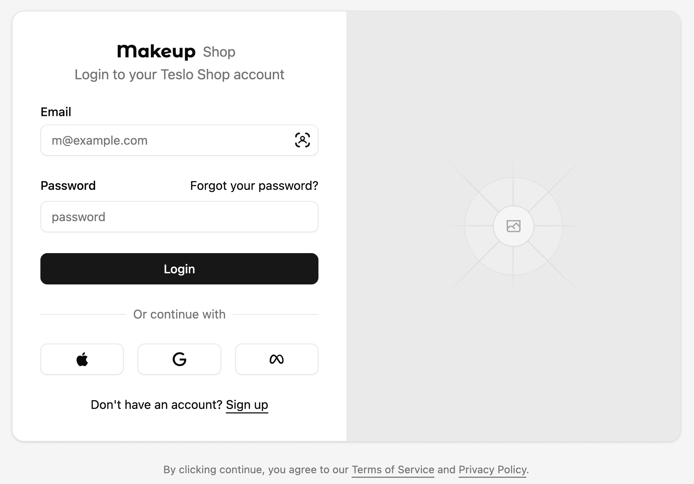
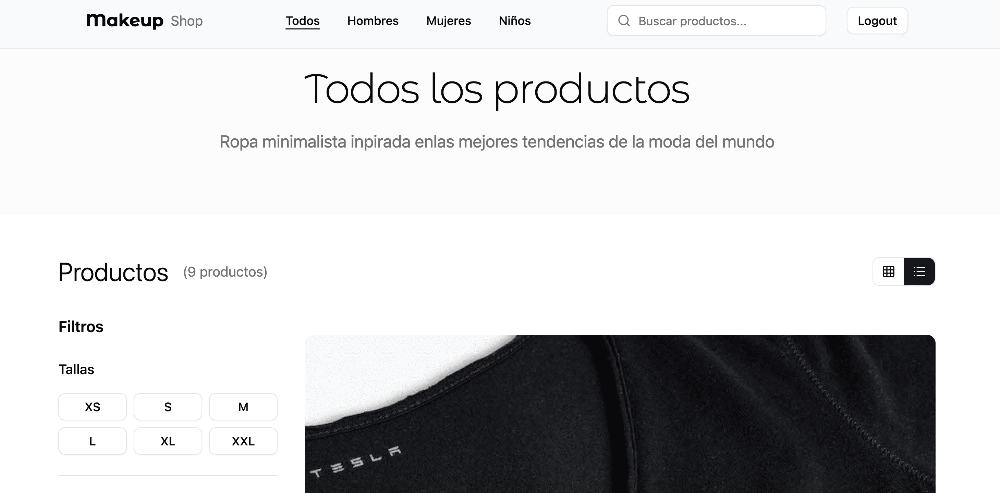
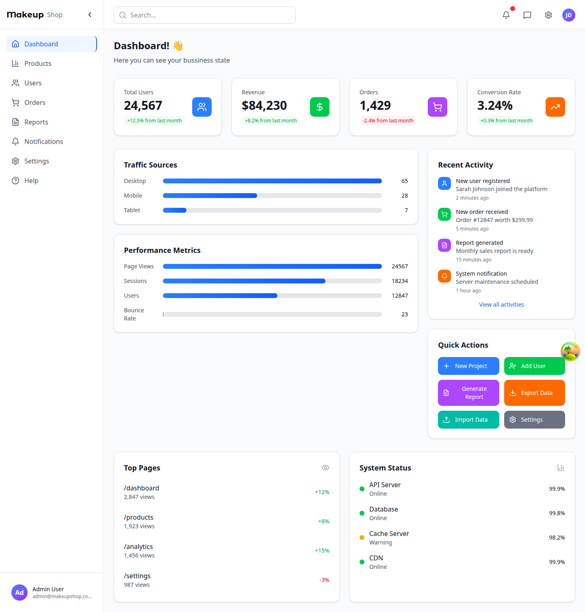
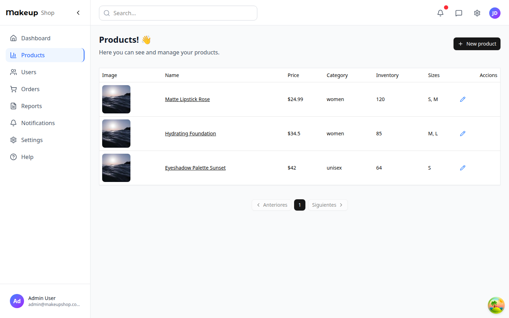
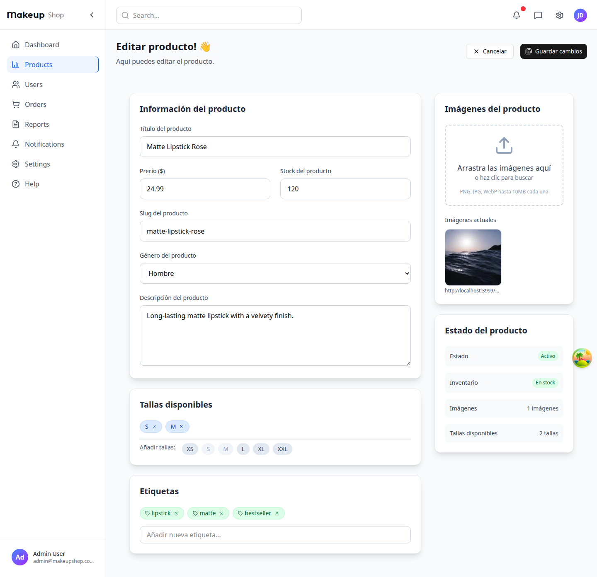

# Makeup Shop

A modern e-commerce frontend for browsing and managing makeup products. Built with React and TypeScript, it includes a public storefront, user authentication, and an admin dashboard.

## Features

- **Storefront** — Browse products, filter by gender, and view product details
- **Authentication** — Login and registration with protected routes
- **Admin panel** — Dashboard, product list, and create/edit product forms
- **Responsive UI** — Tailwind CSS with shadcn/ui components

## Tech Stack

| Category | Technologies |
| --- | --- |
| Framework | React 19, TypeScript, Vite |
| Styling | Tailwind CSS 4, shadcn/ui |
| State & data | Zustand, TanStack Query, Axios |
| Routing | React Router 7 |
| Forms | React Hook Form |

## Getting Started

### Prerequisites

- [Node.js](https://nodejs.org/) 18 or later
- npm (comes with Node.js)

### Installation

1. **Clone the repository**

   ```bash
   git clone https://github.com/freddyarh/shop.git
   cd shop
   ```

2. **Install dependencies**

   ```bash
   npm install
   ```

3. **Configure environment variables**

   Copy the template file and set your API URL:

   ```bash
   cp .env.template .env
   ```

   Then edit `.env` and add your backend URL:

   ```env
   VITE_API_URL=http://localhost:3000/api
   ```

4. **Start the development server**

   ```bash
   npm run dev
   ```

   Open [http://localhost:5173](http://localhost:5173) in your browser.

## Available Scripts

| Command | Description |
| --- | --- |
| `npm run dev` | Start the development server |
| `npm run build` | Type-check and build for production |
| `npm run preview` | Preview the production build locally |
| `npm run lint` | Run ESLint |

## Project Structure

```
src/
├── admin/          # Admin dashboard and product management
├── auth/           # Login, register, and auth store
├── shop/           # Storefront pages and components
├── components/     # Shared UI and custom components
├── api/            # Axios client configuration
└── app.router.tsx  # Application routes
```

## Screenshots

### Storefront

#### Login

<p align="center">
  
</p>

#### Home

<p align="center">
  
</p>

### Admin Panel

#### Dashboard

<p align="center">
  
</p>

#### Products

<p align="center">
  
</p>

#### Edit Product

<p align="center">
  
</p>

## License

This project is for educational and portfolio purposes.
